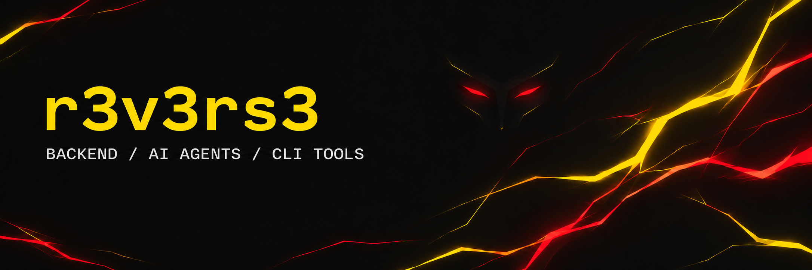

# Peterson Andres Sena
### aka r3v3rs3

 

  

  

Dominican roots. Barcelona based.  
Backend developer building tools, plugins, and workflows for AI agents.

---

### Building

- **[Corvusmem](https://github.com/petersonsenadevs/corvusmem)** — Local memory for AI agents.
- **Senzu** — My own developer tooling.
- **Backend & integrations** — APIs, ecommerce systems, and automation.

Exploring local LLMs, agent orchestration, and better terminal experiences.

### Stack

---

### Commits & activity

  

 

Built in the terminal. Shipped to the world.

